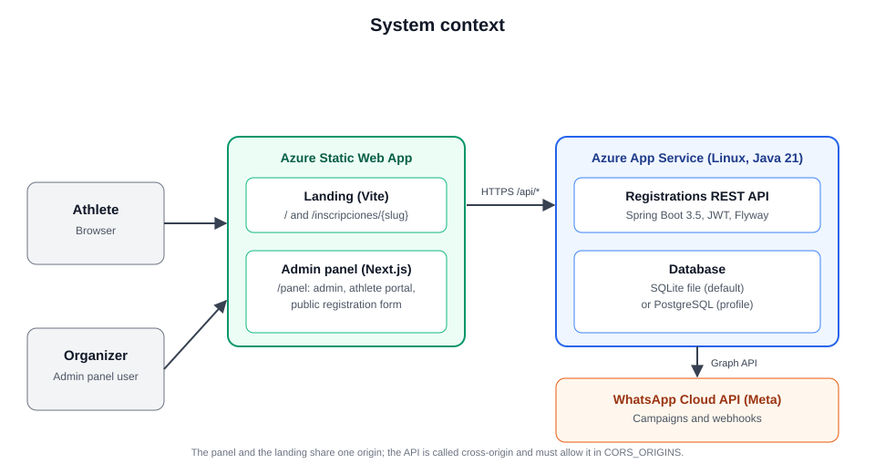
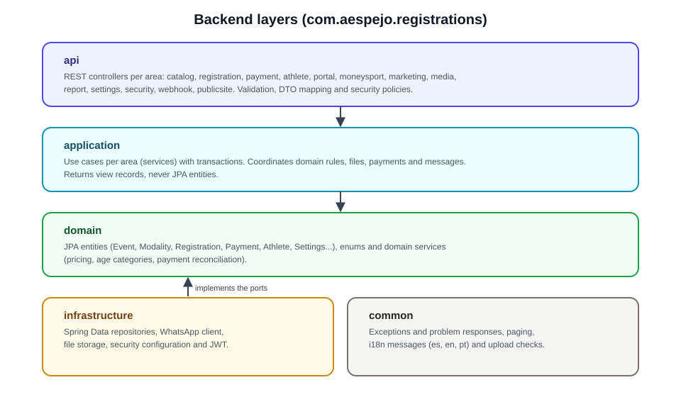
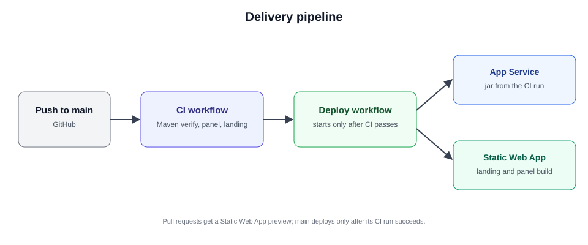
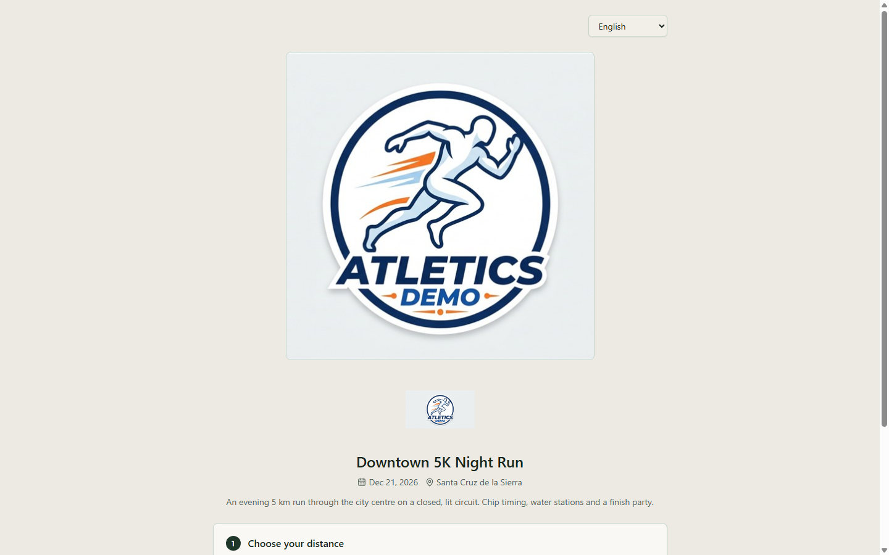
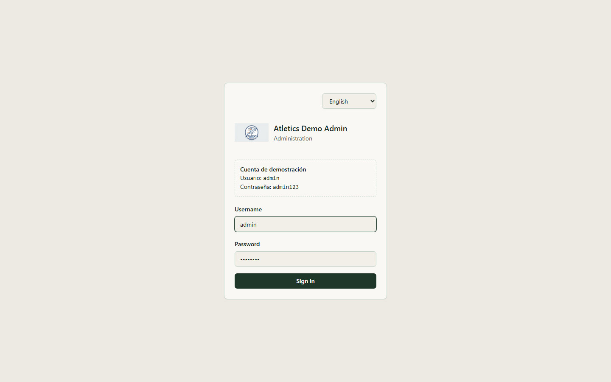
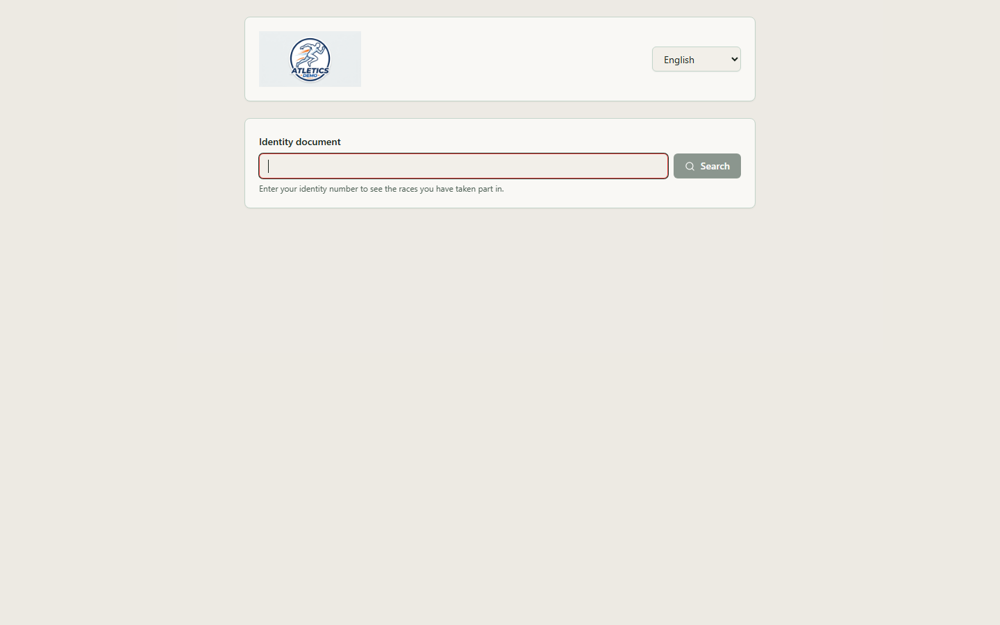

# AEspejo.Registrations

Registration system for sports events: event and modality catalog, public registration form,
reconcilable payments, reports, and a reusable athlete base across editions for WhatsApp campaigns.

The backend is a REST API written in **Java 21 + Spring Boot 3.5** on **SQLite** by default, with **PostgreSQL** as an option by configuration. It is a new
implementation and does not reuse any earlier backend.

## Language

Everything in this repository is in English: classes, methods, folders, file names, enums, comments,
tables, columns, configuration keys, API routes, Markdown documents and commit messages. The only
exception is text shown to end users in the frontend UI, which may be Spanish or any other language
through i18n. The full rule and its exceptions are in [`CLAUDE.md`](CLAUDE.md) and
`.specify/memory/constitution.md` (Principle I). Canonical names are in [`docs/glossary.md`](docs/glossary.md).

## Structure

| Folder | Contents |
|---|---|
| `src/AEspejo.Registrations.Backend` | REST API (Spring Boot, JPA, Flyway) |
| `src/AEspejo.Registrations.Frontend` | Admin panel (Next.js), consumes the API |
| `src/AEspejo.Landing.AthleticsDemo` | Public landing page (Vite) |
| `deploy/` | Docker Compose file for PostgreSQL |
| `docs/` | Project documentation and glossary |
| `specs/` | Feature specifications (spec, plan, tasks) |

## Technical overview

| Area | Technology |
|---|---|
| Backend | Java 21, Spring Boot 3.5, Spring Web, Spring Data JPA, Spring Security with JWT, Flyway, springdoc (OpenAPI) |
| Database | SQLite (default, a single file) or PostgreSQL 17/18 with the `postgresql` profile |
| Admin panel | Next.js 15 (static export), React 19, TanStack Query, Tailwind CSS, i18next (English by default; Spanish and Portuguese) |
| Landing | Vite, plain HTML/JavaScript, with the public event calendar |
| Hosting | Azure Static Web Apps (landing and panel under `/panel`) and Azure App Service on Linux (API) |
| CI/CD | GitHub Actions: CI on every push and pull request, deploy to Azure after a successful CI run on `main` |

### Main functional areas

- **Catalog:** events, modalities (distances), price tiers by date, kits and their items, sizes, and age categories generated from templates.
- **Registration:** public form with a liability waiver, reservations that expire, a document lookup that pre-fills known athletes, and kit size selection.
- **Payments:** payments recorded by hand or reconciled from bank statements, with a payment tolerance and a fixed service fee per event.
- **Athlete base:** athletes reused across editions, with import of spreadsheets and opt-in tracking for marketing.
- **Money Sport:** credit per finished event, applied as a discount on the next registration.
- **Athlete portal:** athletes sign in with their document to see their registrations, complete their account and claim past registrations.
- **Campaigns:** WhatsApp messages to segments of athletes through the WhatsApp Cloud API, with webhook handling for delivery status.
- **Reports and settings:** operational reports and organization settings, including the currency shown with every amount (USD by default).

### Security and roles

- The panel signs in with a username and password and receives a JWT. Administrative endpoints are protected by role policies.
- Roles: `Admin`, `Cashier`, `KitStaff` and `ReadOnly`.
- Public endpoints (`/api/public/**`) expose only the event catalog, the sign-up and the organization name and currency. The API never returns the internal settings or the fees to the public.
- Uploaded files are checked by their content (image and document signatures), not by their extension.

### Internationalization

- The API returns validation and business messages in the language of the request (`Accept-Language`): Spanish, English or Portuguese.
- The panel and the public pages use i18next. English is the default; the language can be changed in the header and is remembered in the browser.
- Text stored in the database (event names, waiver text) is written by the organizer and is not translated.

## Architecture

### System context

The browser reaches a single Static Web App for the landing and the panel. The panel calls the REST API
on App Service across origins, so the API must list the site origins in `CORS_ORIGINS`.



### Backend layers

The backend is organized in layers under `com.aespejo.registrations`. Controllers depend on application services,
services depend on domain entities and repositories, and infrastructure implements the ports used by the application
(persistence, WhatsApp, file storage). Application services return view records, so JPA entities never leave the service layer.



| Package | Responsibility |
|---|---|
| `api` | REST controllers grouped by functional area |
| `application` | Use cases with transactions, one package per area |
| `domain` | JPA entities, enums and domain services |
| `infrastructure` | Repositories, WhatsApp client, file storage, security configuration |
| `common` | Exceptions and problem responses, paging, i18n messages, upload checks |

### Database and migrations

- Flyway applies `db/migration/common` (reference data) and then the folder of the active database
  (`sqlite` or `postgresql`). Each migration is versioned, so an existing installation only receives the new ones.
- Hibernate runs with `ddl-auto: validate`: the application refuses to start if the entities do not match the schema.
- SQLite runs in WAL mode with foreign keys enabled. PostgreSQL is supported by the same entities through the `postgresql` profile.

### Delivery pipeline

Every push to `main` runs the CI workflow, which compiles and tests the backend, type-checks and builds the panel,
and builds the landing. When CI succeeds, the deploy workflow publishes the API jar to App Service and the combined
landing and panel to the Static Web App, using the same commit. Pull requests get a Static Web App preview.



## Screenshots

| Landing | Public registration form |
|---|---|
|  |  |

| Admin sign-in | Athlete portal |
|---|---|
|  |  |

## Requirements

- JDK 21
- Node.js 22+
- Nothing else for SQLite. PostgreSQL 17 or 18 only for the `postgresql` profile

## Database

The backend uses **SQLite by default**: the database is the file `App_Data/registrations.db`, created on the first start,
with no installation needed. To use **PostgreSQL** instead, start the backend with the `postgresql` profile:

```bash
SPRING_PROFILES_ACTIVE=postgresql DB_URL=jdbc:postgresql://localhost:5432/registrations DB_USER=registrations DB_PASSWORD=... ./mvnw spring-boot:run
```

The Windows development machine does not use Docker: Docker Desktop fails to start with
"Virtualization support not detected". PostgreSQL 18 runs as a local Windows service on port 5432. On a machine
where Docker works, the Compose file in `deploy/` starts PostgreSQL:

```bash
cd deploy
# Create a .env file next to the compose file with POSTGRES_PASSWORD=...
docker compose -f docker-compose.postgres.yml up -d
```

Flyway applies the migrations of the selected database: `db/migration/sqlite` or `db/migration/postgresql`, plus the
shared reference data in `db/migration/common` (the two brands).

## Backend

Environment variables read by `application.yml`:

| Variable | Default | Purpose |
|---|---|---|
| `SPRING_PROFILES_ACTIVE` | empty (SQLite) | Set to `postgresql` to use PostgreSQL |
| `DB_URL` | `jdbc:sqlite:App_Data/registrations.db` | Database URL. With the `postgresql` profile, use `jdbc:postgresql://…` |
| `DB_USER` | empty | Database user (PostgreSQL profile only) |
| `DB_PASSWORD` | empty | Database password |
| `JWT_SECRET` | empty | Secret used to sign tokens |
| `INITIAL_ADMIN_PASSWORD` | empty | Password of the initial administrator |
| `WHATSAPP_PROVIDER` | `simulated` | `meta` sends through the WhatsApp Cloud API; `simulated` only logs the send |
| `WHATSAPP_BUSINESS_ACCOUNT_ID` | empty | WhatsApp Business account id (default for every brand) |
| `WHATSAPP_PHONE_NUMBER_ID` | empty | Sending number id (default for every brand) |
| `WHATSAPP_TOKEN` | empty | Access token of the Meta app |
| `WHATSAPP_BRANDS_<CODE>_PHONE_NUMBER_ID` | empty | Per-brand override, for example `WHATSAPP_BRANDS_ECOTRAIL_PHONE_NUMBER_ID`. The same pattern applies to `_TOKEN`, `_BUSINESS_ACCOUNT_ID`, `_PROVIDER` |
| `WHATSAPP_WEBHOOK_VERIFY_TOKEN` | empty | Token of the webhook handshake configured in Meta |
| `WHATSAPP_WEBHOOK_APP_SECRET` | empty | App secret used to verify the `X-Hub-Signature-256` signature of webhook calls |
| `CORS_ORIGINS` | empty | Comma-separated origins allowed to call the API from a browser, for example the landing pages in development: `https://localhost:5173,https://localhost:5174` |

```bash
cd src/AEspejo.Registrations.Backend
./mvnw spring-boot:run        # Windows: mvnw.cmd spring-boot:run
```

The API listens on `http://localhost:5183`. OpenAPI documentation is provided by springdoc.

Compile and run the tests:

```bash
./mvnw verify
```

## Admin panel

```bash
cd src/AEspejo.Registrations.Frontend
npm install
npm run dev
```

The panel runs on `http://localhost:5173` and forwards `/api/*` to the backend on port 5183.
Per-brand builds: `npm run build:ecotrail` and `npm run build:onesport`.

## Landing page

```bash
cd src/AEspejo.Landing.AthleticsDemo
npm install
npm run dev
```

The event calendar is loaded from `src/AEspejo.Landing.AthleticsDemo/landing/eventos.js`.

## Migration status

- Backend: 30 JPA entities and the enum converters are implemented. Schema validation against
  the selected database (`ddl-auto: validate`) is checked at startup.
- Feature status and requirements are described in `specs/`.
